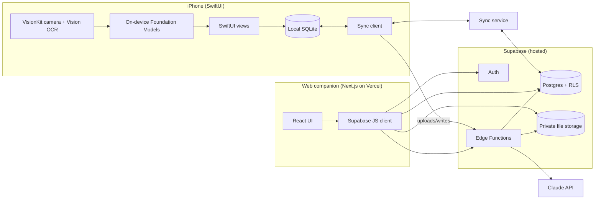
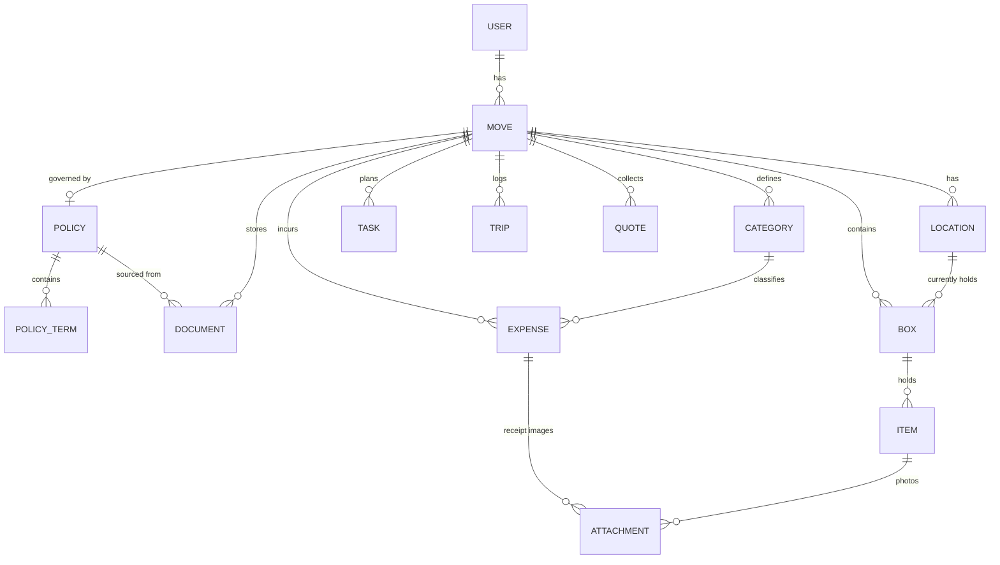
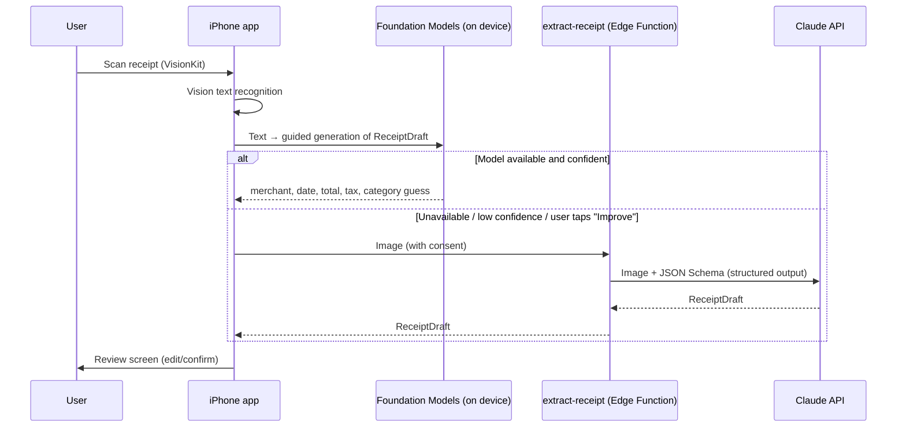

# Relo: Architecture

| | |
|---|---|
| **Status** | Proposed v0.1 |
| **Last updated** | 2026-11-10 |
| **Requirements** | [PRD.md](PRD.md) |
| **Decisions** | [adr/](adr/) (ADRs: Architecture Decision Records, short documents explaining each major choice and its alternatives) |

---

## 1. Overview

Relo is a **local-first** system: the iPhone app reads and writes a database on the device, and a sync layer reconciles it with a hosted Postgres database. The web companion talks to the hosted database directly. Heavy or secret-bearing work (AI (Artificial Intelligence) document extraction, report generation) runs in server-side functions.



Abbreviations used in the diagram: OCR (Optical Character Recognition, reading text from images); RLS (Row-Level Security, Postgres rules that limit each user to their own rows); JS (JavaScript).

## 2. Key decisions at a glance

| Decision | Choice | ADR |
|---|---|---|
| Client platforms | Native SwiftUI iPhone app + Next.js web companion | [0002](adr/0002-swiftui-ios-plus-nextjs-web.md) |
| Backend | Supabase: Postgres, Auth, Storage, Edge Functions | [0003](adr/0003-supabase-backend.md) |
| Offline and sync | Local SQLite on device + PowerSync sync engine (accepted after spike; field-level merge, last upload wins) | [0004](adr/0004-offline-first-sync.md) |
| Document extraction | Receipts on device first (Vision + Foundation Models); policies in the cloud (Claude API), quote-verified, human-confirmed | [0005](adr/0005-document-extraction.md) |
| Repo shape | Monorepo: `apps/ios`, `apps/web`, `supabase/`, shared JSON Schemas | §10 |

## 3. iPhone app

**Stack:** Swift 6 (strict concurrency checking), SwiftUI, Observation (`@Observable`), minimum iOS 26 (needed for the on-device Foundation Models framework; devices without Apple Intelligence fall back to cloud extraction).

**Structure:** one thin app target plus local Swift packages, so domain logic is testable without the simulator:

| Package | Responsibility |
|---|---|
| `RelocDomain` | Pure Swift models and rules: package types, allowance math, clawback calculator, box code generator. No UI or I/O (input/output). Highest test coverage. |
| `RelocData` | Local database schema, queries, repositories, sync client wrapper |
| `RelocCapture` | Document camera (VisionKit), text recognition (Vision), on-device extraction (Foundation Models), QR (Quick Response) code generation and scanning |
| `RelocAPI` | Supabase client: auth, file upload, Edge Function calls |
| `RelocUI` | Design system: colors, typography, components, accessibility helpers |
| `Feature*` | One package per feature area: `FeatureExpenses`, `FeatureBoxes`, `FeaturePolicy`, `FeatureTasks`, `FeatureDocuments` |

**Patterns:**
- Views own lightweight `@Observable` view models; view models depend on protocols (repositories, services) injected through the SwiftUI environment, so tests and previews use in-memory fakes.
- `NavigationStack` with typed routes; a deep-link router handles `https://<domain>/b/<box-code>` universal links from QR labels.
- Writes go to the local database first, and the UI never waits on the network.
- Photos are written to the app's container first, then uploaded by a background `URLSession` so uploads survive the app being suspended.

## 4. Web companion

**Stack:** Next.js (App Router), TypeScript, Tailwind CSS, Supabase JS client with server-side rendering auth helpers, deployed on Vercel.

**Purpose:** desktop-shaped tasks: printing QR label sheets, reviewing and editing expenses in a table, uploading policy PDFs (Portable Document Format) by drag-and-drop, exporting reports, and viewing a box's contents from a scanned label when the app isn't installed.

The web app is online-only (no offline requirement) and reads and writes Postgres directly under RLS. Generated TypeScript types (`supabase gen types`) keep it in sync with the schema.

## 5. Backend (Supabase)

| Component | Use |
|---|---|
| **Auth** | Sign in with Apple, email magic link. Issues JWTs (JSON Web Tokens) that carry the user ID used by RLS. |
| **Postgres** | Source of truth. Every user-owned table has `user_id` and RLS policies `user_id = auth.uid()`. |
| **Storage** | Private buckets `receipts`, `documents`, `item-photos`. Object paths start with the user ID (`{user_id}/{move_id}/...`); storage policies check that first segment. Clients get short-lived signed URLs. |
| **Edge Functions** (TypeScript on Deno) | `extract-policy`, `extract-receipt` (cloud fallback), `export-report`. Hold the Anthropic API key as a secret; verify the caller's JWT; rate-limit per user. |
| **Migrations** | SQL migrations in `supabase/migrations`, applied by CI. RLS policies tested with pgTAP (a Postgres unit-testing framework). |

**Environments:** `local` (Supabase CLI in Docker), `staging`, `production`. Each has its own project and keys; the iPhone app picks one per build configuration.

## 6. Data model



Key tables and fields (abridged; full DDL (Data Definition Language, the SQL that creates tables) lives in migrations):

| Table | Notable columns |
|---|---|
| `moves` | `origin_address`, `destination_address`, `move_date`, `start_date`, `is_active` |
| `policies` | `package_type` (`lump_sum` / `itemized` / `vendor_managed` / `hybrid`), `currency`, `status` (`draft` / `active`) |
| `policy_terms` | `kind` (e.g. `lump_sum_amount`, `category_cap`, `required_vendor`, `clawback_rule`, `deadline`, `approval_required`, `open_question`), `value jsonb` (typed per kind, validated against a JSON Schema), `source_document_id`, `source_page`, `source_quote`, `quote_verified bool`, `confidence`, `review_state` (`pending` / `confirmed` / `edited` / `rejected`) |
| `expenses` | `amount_cents bigint`, `currency`, `occurred_on`, `merchant`, `category_id`, `payer` (`me` / `employer` / `vendor_direct`), `tax_tags text[]`, `extraction_source` (`manual` / `on_device` / `cloud`), `missing_receipt bool` |
| `boxes` | `code` (e.g. `K-014`, unique per move), `origin_room`, `destination_room`, `location_id`, `status`, `flags text[]` (`fragile`, `heavy`, `open_first`) |
| `items` | `box_id` (nullable for loose items), `name`, `value_cents`, `disposition` (`keep` / `sell` / `donate` / `toss`) |
| `attachments` | `owner_type`, `owner_id`, `storage_path`, `mime_type`, `sha256`, `upload_state` |

**Conventions:**
- Primary keys are UUIDs (Universally Unique Identifiers) generated **on the client**, so records can be created offline without collisions.
- Money is stored as integer cents plus a currency code, never floating point.
- Every row has `created_at`, `updated_at`, `deleted_at` (soft delete, so deletions sync).
- Clawback and allowance numbers are **computed**, not stored, by `RelocDomain` (iPhone) and an equivalent SQL view (web), with shared test vectors to keep the two implementations identical.

## 7. Document extraction pipelines

### 7.1 Receipts: on device first



Receipts are usually processed **without leaving the device**: private, free, and works offline. The cloud path is a fallback.

### 7.2 Relocation policies: cloud, verified, confirmed

```mermaid
sequenceDiagram
  participant U as User
  participant Client as iPhone or web
  participant S as Storage (private)
  participant Fn as extract-policy (Edge Function)
  participant C as Claude API
  participant DB as Postgres
  U->>Client: Upload PDF, accept consent screen
  Client->>S: Upload to documents bucket
  Client->>Fn: extract(document_id)
  Fn->>S: Fetch PDF
  Fn->>C: PDF document block + extraction prompt + JSON Schema
  C-->>Fn: Terms[] each with page, verbatim quote, confidence; open_questions[]
  Fn->>Fn: Verify every quote appears in the PDF text (normalized match)
  Fn->>DB: Insert policy_terms (review_state = pending, quote_verified = true/false)
  Client->>U: Review screen: term ↔ highlighted quote, Confirm / Edit / Reject
```

Design points:
- **Model:** Claude Opus 5.5 (`claude-opus-5-5`) through the official `@anthropic-ai/sdk` TypeScript SDK (Software Development Kit), with adaptive thinking, **structured outputs** (`output_config.format` with a JSON Schema) so the response always parses, and the server-side refusal fallback enabled. The model ID is configuration, not code, so it can be re-evaluated later.
- **Provenance without the citations feature:** the API's built-in citations can't be combined with structured outputs, so the schema asks for `source_page` and `source_quote` per term, and the function checks each quote against the PDF's extracted text. Unverified terms are shown with a warning and can't be confirmed without an edit.
- **Nothing is trusted until a human confirms it** (PRD POL-5). Budgets and the clawback tracker read only `confirmed` and `edited` terms.
- **Evaluation set:** `supabase/functions/extract-policy/evals/` holds fictional sample policies (lump sum, itemized with caps, vendor-managed, hybrid, plus a messy scanned one) with expected terms. A script scores precision and recall per term kind and counts invented terms. It runs on demand and before any prompt or model change. This is the measurable quality story for the portfolio.
- **Privacy:** consent screen first (PRD POL-7); documents sent only to the extraction call; no document content in logs; the Anthropic key never leaves the server.

## 8. Sync and offline

Summary (details and alternatives in [ADR-0004](adr/0004-offline-first-sync.md)):

- The device holds a SQLite copy of the user's rows (sync rules: "all rows where `user_id` = me").
- Local writes are queued in an upload queue and applied to Postgres through a small write API (Edge Function or PostgREST, the auto-generated REST API (Representational State Transfer) Supabase exposes over Postgres) that validates the payload; RLS still applies.
- Conflict policy (measured in the spike): **per-field merge, last upload wins**. Edits to different fields both survive; for the same field, whichever edit reaches the server last wins, even if it was made earlier offline. Acceptable for a single-user app; household sharing (later) may need edit-timestamp checks.
- The server can reject a queued write (constraint violation); the device then drops that row. The app validates locally first (mirroring database constraints) and surfaces any rejected upload.
- Deletes: the app soft-deletes (`deleted_at`), sync config excludes deleted rows, and a scheduled job purges them after 30 days.
- Files sync separately: attachment rows sync immediately with `upload_state = pending`; the binary uploads in the background and flips to `uploaded`.

## 9. Security and privacy

| Threat | Control |
|---|---|
| User A reads user B's data | RLS on every table and storage bucket; pgTAP tests that try cross-user reads and must fail |
| Leaked API keys | Only the Supabase anon key ships in clients (safe by design under RLS); the Anthropic key lives in Edge Function secrets; secret scanning in CI |
| Lost or stolen phone | Data protected by iOS file protection (`completeUntilFirstUserAuthentication`); optional Face ID lock for the documents vault |
| Sensitive content in logs or crash reports | Structured logging with redaction; crash reporting configured to drop request bodies and user content |
| Abuse of paid AI endpoint | JWT required, per-user rate limit and monthly quota, max file size and page count |
| Real PII (Personally Identifiable Information) in the public repo | `private/` git-ignored; fixtures are fictional; pre-commit and CI secret scanning |
| Account deletion | Cascading delete of rows and storage objects; data export available first (PRD ACCT-4) |

## 10. Repository layout

```text
relo/
├── apps/
│   ├── ios/                 # Xcode project + local Swift packages
│   └── web/                 # Next.js app
├── supabase/
│   ├── migrations/          # SQL schema + RLS policies
│   ├── functions/           # Edge Functions (TypeScript/Deno), with evals/
│   ├── tests/               # pgTAP database tests
│   └── seed.sql             # Fictional demo data
├── schemas/                 # JSON Schemas shared by extraction, web, iOS (codegen to TS + Swift)
├── docs/                    # PRD, architecture, roadmap, ADRs
├── .github/workflows/       # CI
└── private/                 # Git-ignored: real personal documents for local testing only
```

## 11. Quality: testing, CI/CD, observability

**Testing pyramid**

| Layer | Tooling | Focus |
|---|---|---|
| Domain unit tests | Swift Testing | Allowance math, clawback proration and caps, box codes, category suggestion |
| Data/sync tests | Swift Testing + in-memory SQLite | Offline write → reconnect → server state; conflict cases |
| UI tests | XCUITest, plus snapshot tests for key screens (light/dark, large Dynamic Type) | Capture flow, box scan flow |
| Web | Vitest (unit), Playwright (end-to-end) | Label sheet layout, expense table, auth |
| Database | pgTAP | RLS: every table denies cross-user access |
| AI extraction | Eval script over the fictional policy set | Precision, recall, invented-term count |

**CI/CD (Continuous Integration / Continuous Delivery)** on GitHub Actions:
- On every PR (pull request): Swift build + tests (macOS runner), web lint + type-check + tests, `supabase db lint` + pgTAP against a local Supabase, secret scan.
- On merge to `main`: deploy web to Vercel staging, apply migrations to staging, upload an iOS build to TestFlight (via fastlane or Xcode Cloud).
- Production promotion is manual and tagged.

**Observability:** Sentry for crashes and errors on iPhone, web, and functions, with content redaction; Supabase logs for database and functions; a lightweight privacy-respecting analytics event set (screen views and feature usage only, no content).

## 12. Cost at personal scale (estimate)

| Service | Expected tier |
|---|---|
| Supabase | Free tier at first; Pro (~$25/month) if storage or uptime needs grow |
| Vercel | Hobby (free) |
| PowerSync | Cloud free tier (2 GB synced/month, 50 clients; deactivated after 1–2 weeks idle) or self-hosted (Apache-2.0) |
| Claude API | Policy extraction: a few cents per document. Receipt fallback: fractions of a cent each. Monitor with per-user quotas. |
| Apple Developer Program | $99/year, required for TestFlight and App Store |
| Sentry | Free developer tier |

## 13. Open technical questions

1. ~~PowerSync vs. custom sync~~: decided, PowerSync (ADR-0004).
2. Label printing: which label stock sizes to support first (e.g. 2"×4" shipping labels vs. 1"×2.6" address labels).
3. Does Foundation Models' on-device accuracy on crumpled receipts justify it as the default, or should cloud be the default with on-device as the offline path? Decide from the receipt test set in R1.
4. Universal link domain: buy a short domain for labels (`relo.link/b/K-014`-style) vs. use the Vercel subdomain.
