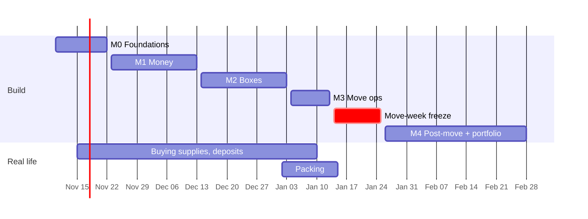

# Relo: Roadmap and Working Plan

| | |
|---|---|
| **Last updated** | 2026-11-10 |
| **Hard date** | Moving week, January 2027 |
| **Requirements** | [PRD.md](PRD.md) · **Design** [architecture.md](architecture.md) |

The schedule is driven by *when each feature is needed in real life*: receipts from the first box purchase (now), box tracking before packing starts (early January), AI (Artificial Intelligence) policy extraction only after the move, since the author's own policy can be entered by hand.

---

## Timeline

## Milestones

### M0: Foundations (Nov 10 – Nov 22)

| Deliverable | Done when |
|---|---|
| Docs: PRD (Product Requirements Document), architecture, ADRs (Architecture Decision Records) 0001–0005, roadmap | Reviewed and committed |
| Monorepo skeleton: `apps/ios`, `apps/web`, `supabase/`, `schemas/` | Each builds from a clean clone with documented commands |
| Supabase: local (CLI, Command-Line Interface) + staging projects, first migration (`moves`, `expenses`) with RLS (Row-Level Security) and pgTAP tests | Cross-user read test fails as expected |
| Auth: Sign in with Apple + magic link on iPhone and web | Sign in on both, same user ID |
| CI (Continuous Integration) on GitHub Actions: Swift tests, web lint/type-check/tests, database tests, secret scan | Green on `main` |
| **Sync spike** (ADR-0004), 3 days max | Exit criteria pass → accept PowerSync; else accept GRDB fallback |
| Apple Developer Program enrollment | TestFlight build installs on the author's iPhone |

### M1: Money (Nov 23 – Dec 13)

Requirements: MOVE-1/2, POL-1/2, EXP-1–6, CLAW-1–3, ACCT-2.

| Deliverable | Done when |
|---|---|
| Move setup + dashboard | Author's move entered |
| Manual policy entry for all four package types | Author's policy terms entered and confirmed |
| Receipt capture → on-device extraction → review | Receipt test set: ≥ 85% of merchant/date/total correct with no edits |
| Expenses: categories, payer, missing-receipt flag, allowance view | Every move purchase from Nov 23 onward logged in-app (**dogfooding starts**) |
| Clawback tracker | Matches hand-calculated values for test vectors (e.g. leave after 4 months → 8/12 of costs, capped at one month's salary) |
| Web: expense table (read/edit) + CSV (Comma-Separated Values) export | Export opens cleanly in a spreadsheet |

### M2: Boxes (Dec 14 – Jan 3)

Requirements: BOX-1–7, ACCT-3 (read + labels). Includes the holiday period; scope is kept tight on purpose.

| Deliverable | Done when |
|---|---|
| Boxes and items with photos, rooms, flags, status | 10 test boxes created in under 5 minutes |
| QR (Quick Response) code labels: universal links, web label-sheet printing | Printed sheet scans correctly with the iPhone Camera app |
| In-app scanner + bulk status update by scanning | Scan 10 boxes to "loaded" in under a minute |
| Offline search | Works in airplane mode across 300 items |
| Web: box detail page for scanned labels | Opens a label's contents with no app installed (after sign-in) |

### M3: Move ops (Jan 4 – Jan 13)

Requirements: TASK-1–3, MILE-1–2, DOC-1–2, VEND-1–2, BOX-8.

| Deliverable | Done when |
|---|---|
| Checklist from template keyed to move date, with notifications | Author's remaining move tasks tracked in-app |
| Mileage trip logging | Ready for the moving drive |
| Document vault | Relocation agreement and lease stored (in the app, never the repo) |
| Mover quotes + required-vendor warning | Quotes compared |
| Keep/sell/donate/toss on items | Lists usable while packing |
| Offline hardening pass | Full day used in airplane mode with zero sync loss |

### Move-week freeze (Jan 14 – Jan 25)

Bug fixes only, no new features. Keep a log of friction points while actually moving; they feed M4 priorities and the case study.

### M4: Post-move and portfolio (Jan 26 – Feb 28)

Requirements: POL-3–8, BOX-9, EXP-7/8, ACCT-3/4.

| Deliverable | Done when |
|---|---|
| AI policy upload + extraction + review UI | Evaluation set: ≥ 90% of terms correct, 0 invented terms after quote verification |
| Unpack mode | Every box reaches "unpacked" |
| Tax tags + PDF (Portable Document Format) report with receipts | Report ready for the 2027 tax filing |
| Data export + account deletion | Verified end to end on staging |
| Accessibility audit (VoiceOver, Dynamic Type, contrast; WCAG (Web Content Accessibility Guidelines) 2.2 AA on web) | Issues fixed or ticketed |
| Public TestFlight beta | External testers invited |
| **Portfolio case study** | See below |

### Later

Household sharing, itemized-reimbursement submission workflow, damage claim packets, multi-move support, App Store release.

## Portfolio deliverables

- **Case study** (README section or personal site): problem, my real move as the first user, key decisions (link ADRs), a hard problem solved (offline sync, or quote-verified AI extraction), before/after metrics, what I'd do differently.
- **Demo video** (60–90 seconds): scan a receipt offline → allowance updates; print and scan a box label; upload a sample policy → confirm terms with highlighted quotes.
- **Architecture diagrams** (already in `architecture.md`, rendered by GitHub).
- **Eval results table** for policy extraction across prompt and model versions.
- **Green CI badges** and test coverage for `RelocDomain`.

## Working practices

| Practice | Convention |
|---|---|
| Branching | Trunk-based: short-lived feature branches → PR (pull request) → squash-merge to `main` |
| Commits | Conventional Commits (`feat(expenses): ...`, `fix(sync): ...`) |
| Tracking | GitHub Issues + a GitHub Projects board; each issue references PRD requirement IDs (e.g. `EXP-2`) |
| PRs | Template: what/why, requirement IDs, screenshots for UI, test evidence; self-review checklist; CI must be green |
| Definition of done | Code + tests + accessibility labels + docs updated + works offline (iPhone) + deployed to staging |
| Releases | Semantic versioning; TestFlight build per merge to `main`; tagged production promotions |
| Secrets and PII (Personally Identifiable Information) | Never committed; `private/` is git-ignored; fixtures are fictional |

## Risks to the schedule

| Risk | Response |
|---|---|
| Sync spike fails | Take the GRDB fallback immediately; budget +1 week in M1 by moving web CSV export to M3 |
| Holidays shrink M2 | BOX-1–6 are the must-haves; bulk scanning and the web box page can slip to M3 |
| Foundation Models accuracy too low on receipts | Make cloud extraction the default when online; on-device stays as the offline path |
| Move logistics consume evenings in January | M3 is small by design; the freeze protects the move itself |
